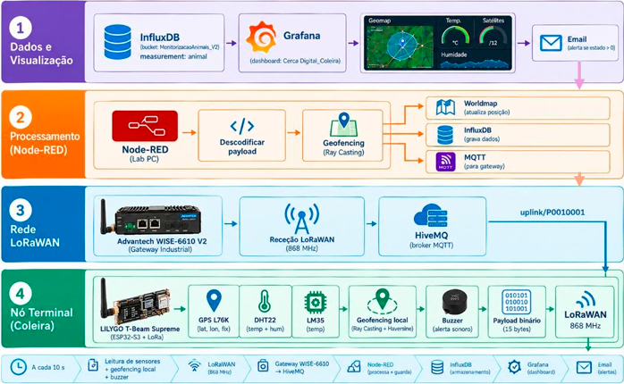
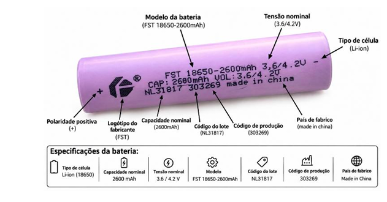
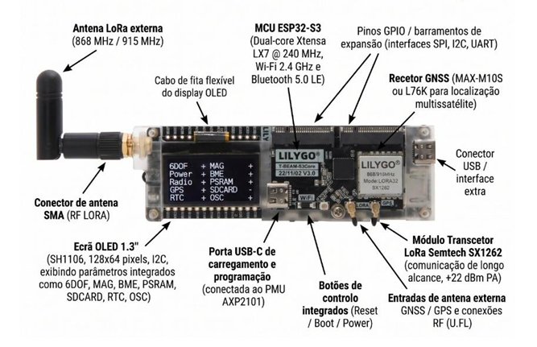
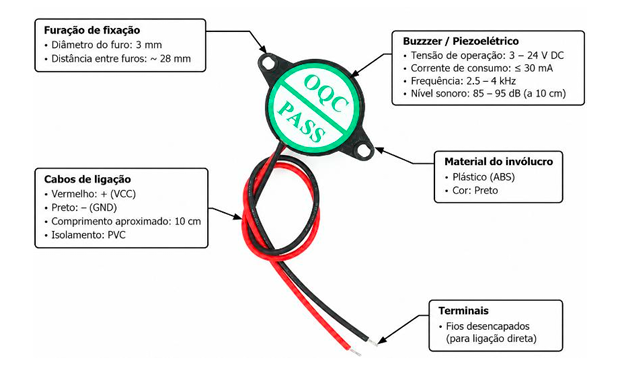
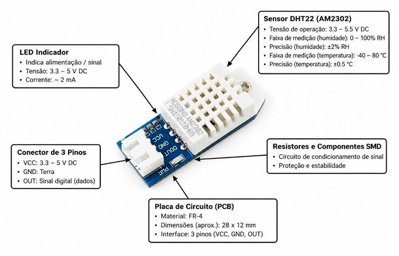
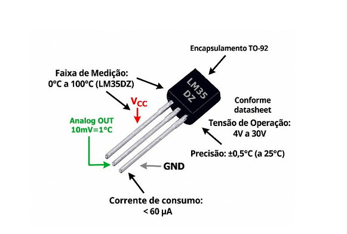
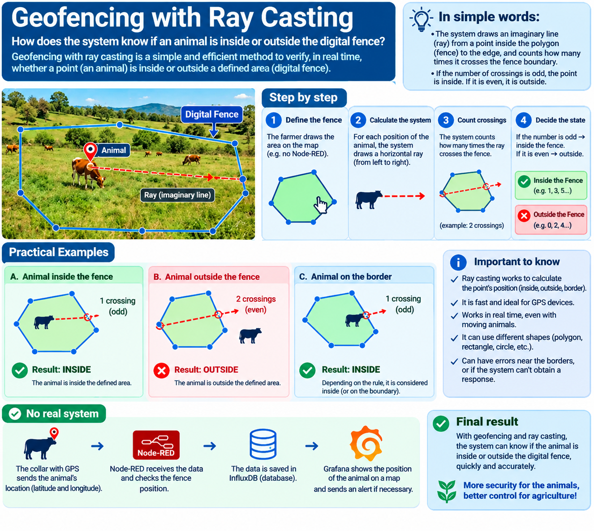

##Cerca Digital para Gestão de Pastoreio e Monitorização Remota de Animais##

Final Course Project — Polytechnic University of Castelo Branco (UPCB-2026)

Author: Letícia Pontes Sindica

## Description

The management of animals in extensive grazing represents one of the most demanding agricultural activities in terms of surveillance and territorial control. Traditional physical fences, although widely used, present high installation and maintenance costs, do not allow dynamic reconfiguration of grazing perimeters, and lack any automatic response capability to critical events, such as the unauthorised exit of animals or their approach to sensitive areas.

This work proposes an alternative solution based on the concept of **digital fencing**: an integrated electronic system that replaces physical barriers with a geographically defined digital perimeter, verified in real time by computational algorithms and capable of triggering automatic alerts on the animal's own collar when the defined boundaries are exceeded.

The developed system is based on **LoRa** wireless communication technology, operating in the European **868 MHz** band according to the **LoRaWAN** protocol, and integrates a low-power terminal node based on the **LilyGO TTGO T-Beam Supreme ESP32-S3** platform. This platform includes a GNSS receiver, the **SX1262** radio transceiver, and an audible alert buzzer.

The real-time data processing and visualisation infrastructure consists of the **Advantech WISE-6610 V2** industrial gateway, the **HiveMQ** MQTT broker, the **Node-RED** platform, the **InfluxDB 2.x** database, and the **Grafana** dashboard system.
## System Architecture — 4-Layer Overview

## Hardware Used

| Component | Description |
|-----------|-------------|
| LilyGO TTGO T-Beam Supreme | ESP32-S3 dual-core Xtensa LX7 240 MHz + LoRa SX1262 + GPS |
| DHT22 | Temperature and humidity sensor (GPIO2) |
| LM35 | Analogue temperature sensor (GPIO3) |
| Buzzer | Audible alert (GPIO39) |
| Advantech WISE-6610 V2 | Industrial LoRaWAN gateway (SX1302 concentrator) |
| FST 18650 Battery | 2600 mAh, 3.6V/4.2V |

## Components

###  Battery — FST 18650

###  ESP32-S3 — LilyGO TTGO T-Beam Supreme

###  Buzzer

###  DHT22 — Temperature & Humidity Sensor

###  LM35 — Analogue Temperature Sensor

## LoRaWAN Communication

| Parameter | Value |
|-----------|-------|
| Band | EU868 (868 MHz, unlicensed ISM) |
| Protocol | LoRaWAN 1.0.3 |
| Activation | OTAA (Over-The-Air Activation) |
| Payload | 15 binary bytes |
| DevEUI |xxxxxxxxxxx |
| Encryption | AES-128 |

## Payload Structure (15 bytes)

| Bytes | Field | Type |
|-------|-------|------|
| 0–3   | Latitude | int32 |
| 4–7   | Longitude | int32 |
| 8–9   | Distance to fence | int16 |
| 10    | Speed | uint8 |
| 11    | Satellites | uint8 |
| 12    | GPS Fix | uint8 |
| 13    | Alert State | uint8 |
| 14    | Temperature | int8 |

Geofencing Algorithm — Ray Casting

The detection of an animal’s position relative to the boundaries of the digital fence is performed using an algorithm called Ray Casting, widely used in geofencing systems for being computationally efficient and suitable for resource-constrained devices.

The operating principle of the algorithm is based on the current position of the animal (defined by the GPS coordinates of latitude and longitude). An imaginary horizontal line (ray) is cast to the right. The system counts how many times this ray intersects the segments that form the perimeter of the digital fence (polygon). If the number of intersections is odd, the animal is inside the fence; if it is even (including zero), the animal is outside.

In this project, the Ray Casting algorithm is implemented at two distinct and complementary levels: on the T-Beam Supreme ESP32-S3, the microcontroller locally executes the algorithm, comparing the animal’s GPS position with the coordinates of the four vertices of the digital fence.

The Ray Casting algorithm verifies in real time whether the animal is inside or outside the digital perimeter:

## Geofencing States

| State | Indicator | Description | Alert |
|-------|-----------|-------------|-------|
| 0 | 🟢 Safe | Animal inside the fence | Silence |
| 1 | 🟡 Warning | Animal within 15 m of the boundary | 10 beeps |
| 2 | 🔴 Breach | Animal outside the fence | 20 beeps + automatic email |

In Node-RED (cloud processing), after receiving data via MQTT, the Node-RED flow re-executes the Ray Casting algorithm with the coordinates received via LoRaWAN, determining the fence_state (0, 1 or 2). The result is stored in InfluxDB and visualised in Grafana, where the animal's marker changes colour according to the state (green — yellow — red).

Software and Platforms

Node-RED

MQTT Broker: Public HiveMQ, topic xxxxxxxx

Main nodes: MQTT In → JSON → Geofencing Ray Casting → InfluxDB + Worldmap

#InfluxDB 2.x

Organisation: CercaDigital

Bucket: MonitorizacaoAnimais_V2

Measurement: animal

#Grafana

Dashboard: Cerca Digital_Coleira

Panels: Geomap, Gauges (temp / humidity / satellites), Time Series, GPS Fix

Alerts: SMTP Gmail port 587, evaluation every 10 seconds

#Battery Life

Mode	Battery Life

Continuous (no sleep)	~11 hours

Repository Structure

## Repository Structure

| Path | Description |
|------|-------------|
| `firmware/CODIGO_CERCADIGITAL.ino` | Main ESP32-S3 firmware |
| `firmware/config.h.example` | Configuration template (keys not included) |
| `flows.json` | Node-RED flows export |
| `dashboard-1793494304853.json` | Grafana dashboard export |
| `docs/images/` | System screenshots |
| `influxdb/README.md` | InfluxDB configuration details |
| `.gitignore` | Excludes real config.h and binaries |
| `README.md` | Project documentation |

## Test Location - EST Campus (IPCB), Castelo Branco

The digital fence was delimited and tested at the **EST campus of UPCB (Escola Superior de Tecnologia)**, 
specifically in the area between **Block A and Block B**, chosen for its open-sky conditions 
that ensure good GPS signal quality.

### GPS Fix Process

Before any geofencing calculation can occur, the ESP32-S3 must obtain a valid **GPS Fix** — 
the process by which the GNSS receiver (Quectel L76K) locks onto enough satellites to 
calculate a reliable position. The system monitors the number of satellites in view and 
only activates geofencing once a stable fix is confirmed, ensuring that false alerts 
caused by inaccurate positions are avoided.

### Satellite Map — Campus EST (IPCB)
 Digital Fence Map

The image above shows the aerial view of the test area with the following elements:

| Element | Description |
|---------|-------------|
| 🔵 Blue polygon | The digital fence perimeter defined by 4 GPS vertices between Block A and Block B |
| 📍 Red marker | Current position of the animal (ESP32-S3 device) inside the fence |
| 🔵 Cyan circle | GPS accuracy radius — represents the margin of uncertainty of the GNSS receiver position |

The GPS accuracy radius (cyan circle) is a fundamental indicator of signal quality: 
the smaller the circle, the more precise the position fix. A larger radius indicates 
reduced satellite visibility or signal interference, which may affect geofencing reliability.

### 🔧 Terminal Node — LilyGO T-Beam Supreme ESP32-S3

The terminal node is the core of the system — the electronic device integrated inside the animal's collar. It combines the **ESP32-S3** dual-core microcontroller (240 MHz), the **LoRa SX1262** radio transceiver, and the **Quectel L76K** GNSS receiver on a single board.

Connected via breadboard, the node integrates three external sensors:
- **DHT22** — measures ambient temperature and relative humidity around the animal
- **LM35** — analogue temperature sensor providing a secondary temperature reading
- **Buzzer** — provides immediate audible alerts directly on the animal when a geofencing boundary is approached or breached

The OLED display shows `PKT:5`, indicating that **5 LoRaWAN packets** have been successfully transmitted to the gateway. Every 10 seconds, the device reads all sensors, calculates its GPS position, runs the Ray Casting geofencing algorithm locally, and transmits a 15-byte encrypted binary payload via LoRaWAN at 868 MHz.

###  LoRaWAN Gateway — Advantech WISE-6610 V2

The **Advantech WISE-6610 V2** is the industrial-grade LoRaWAN gateway that acts as the bridge between the animal's terminal node and the cloud processing infrastructure.

Equipped with the **SX1302 concentrator** chipset, it receives the encrypted LoRaWAN packets transmitted by the ESP32-S3 at **868 MHz** and forwards them over Ethernet via the **MQTT protocol** to the public **HiveMQ broker**. The gateway's rugged aluminium casing and DIN-rail mounting design make it suitable for outdoor agricultural environments.

The side panel shows the gateway's connectivity interfaces: **ETH1/WAN** and **ETH2** Ethernet ports for network connection. The green **PWR LED** confirms the device is powered and fully operational, while the **DAT LED** indicates active data transmission.

###  Node-RED Processing Flow

Node-RED is the central data processing engine of the system. The flow above shows the complete data pipeline from the moment a LoRaWAN packet arrives until it reaches the database and map:

1. **MQTT In** — subscribes to the HiveMQ broker and receives the raw uplink payload
2. **JSON** — parses the MQTT message into a structured JavaScript object
3. **Function 1** — decodes the 15-byte binary payload, extracting GPS coordinates, temperature, humidity, distance, satellites, fix status, and fence vertices
4. **Geofencing Ray Casting** — re-runs the Ray Casting algorithm in the cloud as a redundancy layer, determining the fence state (0, 1 or 2)
5. **Worldmap** — updates the real-time map marker with the animal's current position and colour-coded state
6. **InfluxDB** — stores all decoded fields as time-series data in the `MonitorizacaoAnimais_V2` bucket

The debug nodes (green) allow real-time inspection of each step during development and testing.

###  InfluxDB 2.x — Data Storage

**InfluxDB 2.x** serves as the time-series database for the project. The Data Explorer shows the `MonitorizacaoAnimais_V2` bucket with the `animal` measurement receiving data every 10 seconds.

All fields decoded from the LoRaWAN payload are stored as individual time-series records:

| Field | Description |
|-------|-------------|
| `latitude` / `longitude` | Animal GPS position |
| `cerca_lat_0–3` / `cerca_lon_0–3` | 4 fence vertex coordinates |
| `temperatura` | Temperature reading (°C) |
| `humidade` | Relative humidity (%) |
| `distancia` | Distance to the nearest fence boundary (m) |
| `satelites` | Number of GPS satellites in view |
| `fix` | GPS fix status (0 = no fix, 1 = fix acquired) |
| `estado_cerca` | Geofencing state (0 = safe, 1 = warning, 2 = breach) |

This time-series structure allows Grafana to query and visualise all data historically and in real time.

### 📊 Grafana Dashboard — Cerca Digital_Coleira

The **Cerca Digital_Coleira** dashboard provides real-time monitoring of all animal data received from the LoRaWAN network. It is organised into 6 panels:

- **Temperatura do animal** — gauge displaying the current temperature reading from the DHT22 sensor (°C), with colour thresholds from green (normal) to red (high)
- **Humidade** — gauge displaying relative humidity (%), also colour-coded by threshold
- **Distância ao Limite da Cerca** — gauge showing the calculated distance in metres between the animal's GPS position and the nearest    fence boundary, derived from the Ray Casting algorithm
- **Satélite** — gauge showing the number of GPS satellites currently in view, used to assess fix quality
- **Localização do Animal (Geomap)** — real-time map displaying the animal's position with a colour-coded marker:
 🟢 green (safe)
 🟡 orange (warning)
 🔴 red (breach)
- **Histórico de Temperatura e Humidade** — time series chart showing temperature and humidity evolution over the last 30 minutes
The dashboard auto-refreshes every **5 seconds** and queries InfluxDB with a **10-minute sliding window**.

###  Test Results

Field testing was conducted at the **EST campus of IPCB**, Castelo Branco, 
in the open area between Block A and Block B, chosen for its clear sky 
visibility and good GPS satellite coverage.

The test validated the complete system pipeline across all three geofencing 
states. GPS fix was successfully acquired with **11 to 16 satellites** in view, 
ensuring reliable and accurate positioning throughout the session. The ESP32-S3 
transmitted a 15-byte LoRaWAN payload every 10 seconds, which was received 
without loss by the Advantech WISE-6610 V2 gateway and forwarded via MQTT 
to the Node-RED processing flow.

All payload fields were decoded correctly by Node-RED, stored in InfluxDB, 
and visualised in real time on the Grafana dashboard with a 5-second refresh interval.

**State 0 (Safe)** was confirmed when the animal remained inside the fence perimeter — 
the Geomap displayed a green marker and the buzzer remained silent.

###  State — Secure

**State 1 (Warning)** was triggered as the device approached within 15 metres of 
the fence boundary — the marker turned orange and the buzzer emitted 10 beeps, 
alerting the animal before any breach occurred.

###  State — Risk Zone

**State 2 (Breach)** was confirmed when the device crossed outside the defined 
perimeter — the marker turned red, the buzzer emitted 20 beeps, and an automatic 
email alert was received in Gmail within seconds of the breach being detected 
by the Grafana alerting rule.

### State — Escape

All test cases passed successfully, confirming correct end-to-end operation 
of the Ray Casting geofencing algorithm, LoRaWAN communication, 
cloud processing pipeline, and real-time alert delivery.

###  Grafana Alert Rule & Email Notification

<table>
<tr>
<td align="center"> <b>Grafana Alert Rule — Firing</b></td>
<td align="center"> <b>Automatic Email Alert — Gmail</b></td>
</tr>
</table>

The alerting system is one of the most critical features of the project, ensuring 
that the farmer is immediately notified when the animal exits the digital fence, 
even when away from the monitoring dashboard.

A **Grafana-managed alert rule** named `Alerta Cerca Digital` was configured to 
query InfluxDB every **10 seconds** for the latest `estado_cerca` value stored 
in the `MonitorizacaoAnimais_V2` bucket. The alert threshold is set to fire 
whenever the geofencing state equals or exceeds **1**, covering both the warning 
and breach conditions.

When the alert fires, Grafana sends an automatic email via **Gmail SMTP (port 587)** 
to the configured contact point. The email clearly identifies the alert as 
`cerca-digital › DatasourceNoData`, displays the status as **Firing**, and includes 
a descriptive summary: *"Animal fora da cerca ou perto do limite!"*, with additional 
detail explaining that State 1 indicates the animal is near the boundary and 
State 2 indicates the animal has escaped, instructing the farmer to check the 
dashboard for the current position.

During testing, the email alert was successfully received within seconds of the 
breach being detected, confirming the reliability of the end-to-end alert pipeline 
from InfluxDB query to email delivery.

