##Cerca Digital para Gestão de Pastoreio e Monitorização Remota de Animais##

Final Course Project — Polytechnic University of Castelo Branco (UPCB-2026)

Author: Letícia Pontes Sindica

Description

Complete IoT system for digital fencing (virtual fencing) for remote monitoring of animals in extensive grazing, without the need for physical fences.

The terminal node installed on the animal continuously transmits its GPS location via LoRaWAN EU868, with data processed in real time in Node-RED, stored in InfluxDB and visualised in Grafana with automatic email alerts when the animal exceeds the defined boundaries.

System Architecture

## System Architecture

┌─────────────────────────────────────┐
│     LilyGO T-Beam Supreme ESP32-S3  │
│     GPS + LoRa SX1262               │
│     Ray Casting Geofencing          │
└──────────────┬──────────────────────┘
               │ LoRaWAN 868 MHz
               ▼
┌─────────────────────────────────────┐
│   Gateway Advantech WISE-6610 V2    │
│   LoRaWAN Concentrator SX1302       │
└──────────────┬──────────────────────┘
               │ MQTT — HiveMQ
               │ topic: uplink/xxxxxx
               ▼
┌─────────────────────────────────────┐
│            Node-RED                 │
│   Ray Casting Geofencing            │
│   Decoder + Alerts + Email          │
└──────────┬──────────────────────────┘
           │
           ▼
┌──────────────────┐     ┌────────────────────┐
│   InfluxDB 2.x   │────▶│  Grafana Dashboard │
│ MonitorizacaoAni │     │  Geomap + Gauges   │
│ mais_V2          │     │  Alerts via Email  │
└──────────────────┘     └────────────────────┘

Hardware Used

## Hardware Used

| Component | Description |
|-----------|-------------|
| LilyGO TTGO T-Beam Supreme | ESP32-S3 dual-core Xtensa LX7 240 MHz + LoRa SX1262 + GPS |
| DHT22 | Temperature and humidity sensor (GPIO2) |
| LM35 | Analogue temperature sensor (GPIO3) |
| Buzzer | Audible alert (GPIO39) |
| Advantech WISE-6610 V2 | Industrial LoRaWAN gateway (SX1302 concentrator) |
| FST 18650 Battery | 2600 mAh, 3.6V/4.2V |

## LoRaWAN Communication

| Parameter | Value |
|-----------|-------|
| Band | EU868 (868 MHz, unlicensed ISM) |
| Protocol | LoRaWAN 1.0.3 |
| Activation | OTAA (Over-The-Air Activation) |
| Payload | 15 binary bytes |
| DevEUI |xxxxxxxxxxx |
| Encryption | AES-128 |

## Payload Structure (15 bytes)

| Bytes | Field | Type |
|-------|-------|------|
| 0–3   | Latitude | int32 |
| 4–7   | Longitude | int32 |
| 8–9   | Distance to fence | int16 |
| 10    | Speed | uint8 |
| 11    | Satellites | uint8 |
| 12    | GPS Fix | uint8 |
| 13    | Alert State | uint8 |
| 14    | Temperature | int8 |

Geofencing — Ray Casting

The Ray Casting algorithm verifies in real time whether the animal is inside or outside the digital perimeter:

## Geofencing States

| State | Indicator | Description | Alert |
|-------|-----------|-------------|-------|
| 0 | 🟢 Safe | Animal inside the fence | Silence |
| 1 | 🟡 Warning | Animal within 15 m of the boundary | 10 beeps |
| 2 | 🔴 Breach | Animal outside the fence | 20 beeps + automatic email |

Geofencing runs at two levels (redundancy):

Locally on the ESP32 for immediate buzzer activation
In Node-RED for remote alerts and database logging

Software and Platforms
Node-RED
MQTT Broker: Public HiveMQ, topic xxxxxxxx
Main nodes: MQTT In → JSON → Geofencing Ray Casting → InfluxDB + Worldmap

InfluxDB 2.x
Organisation: CercaDigital
Bucket: MonitorizacaoAnimais_V2
Measurement: animal

#Grafana

Dashboard: Cerca Digital_Coleira

Panels: Geomap, Gauges (temp / humidity / satellites), Time Series, GPS Fix

Alerts: SMTP Gmail port 587, evaluation every 10 seconds

#Battery Life

Mode	Battery Life

Continuous (no sleep)	~11 hours

Repository Structure

## Repository Structure

| Path | Description |
|------|-------------|
| `firmware/CODIGO_CERCADIGITAL.ino` | Main ESP32-S3 firmware |
| `firmware/config.h.example` | Configuration template (keys not included) |
| `flows.json` | Node-RED flows export |
| `dashboard-1793494304853.json` | Grafana dashboard export |
| `docs/images/` | System screenshots |
| `influxdb/README.md` | InfluxDB configuration details |
| `.gitignore` | Excludes real config.h and binaries |
| `README.md` | Project documentation |

System Screenshots

 Digital Fence Map
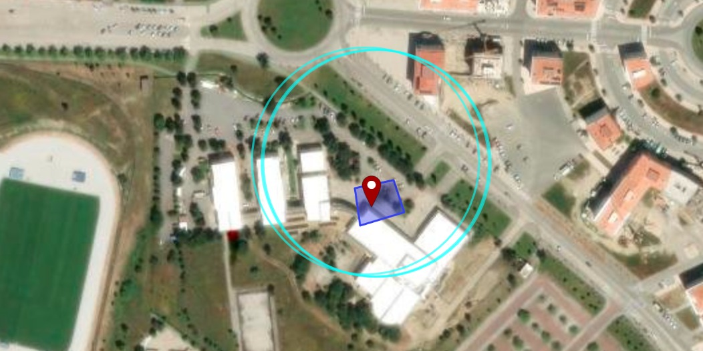

###  ESP32-S3 device
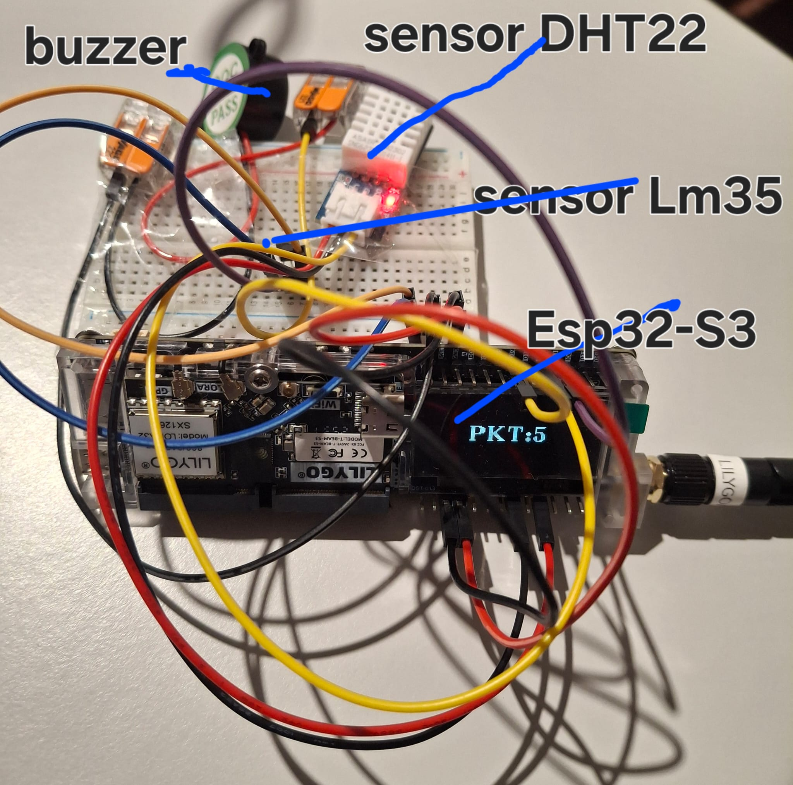

###  Gateway Advantech WISE-6610
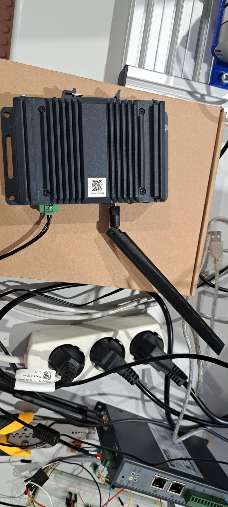
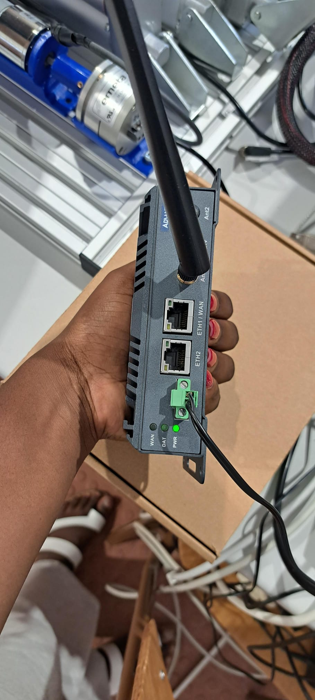
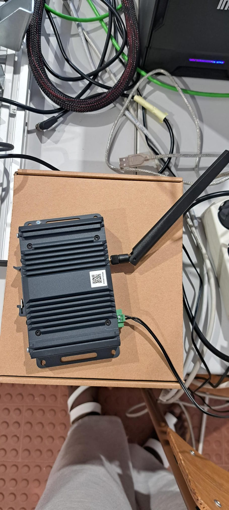

### Node-RED Flow
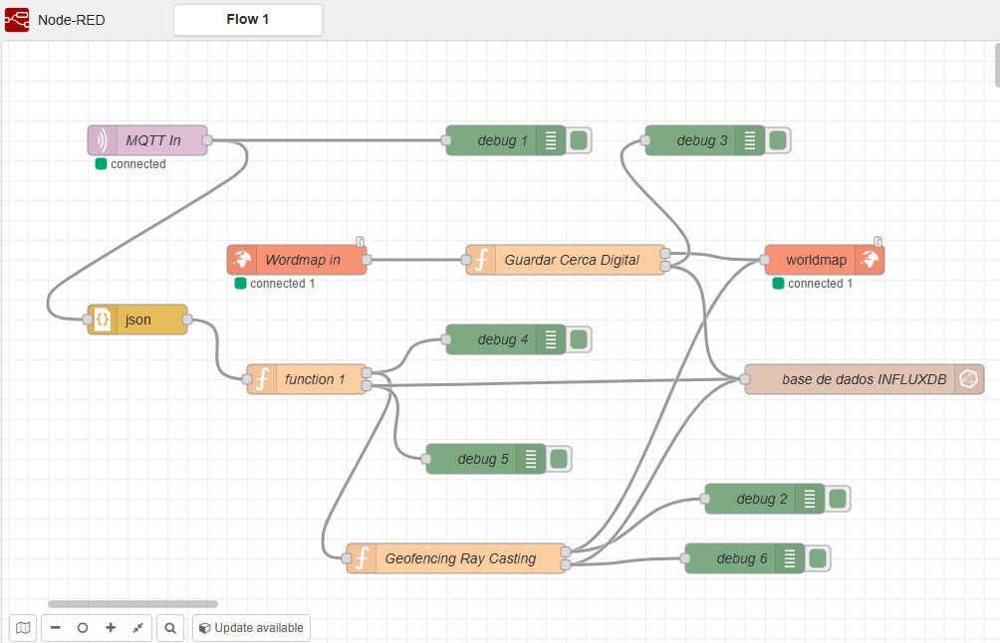

###  InfluxDB
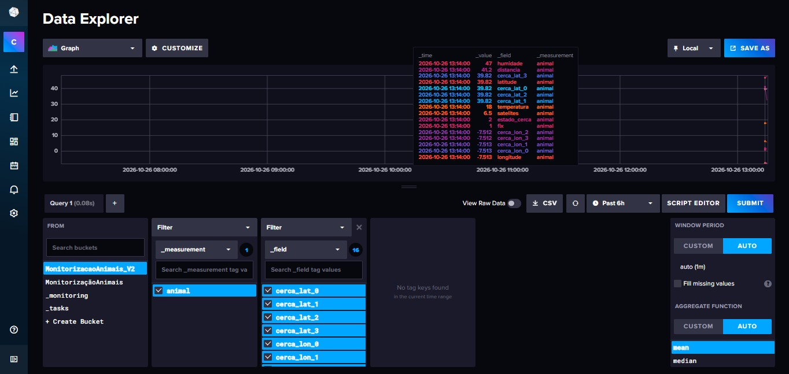

###  State — Secure
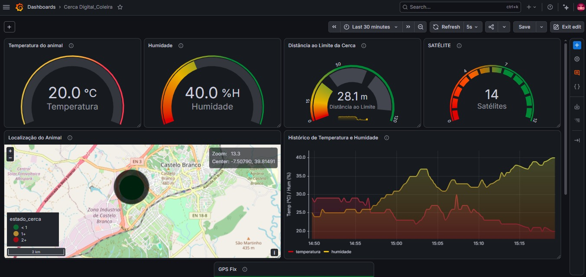

###  State — Risk Zone
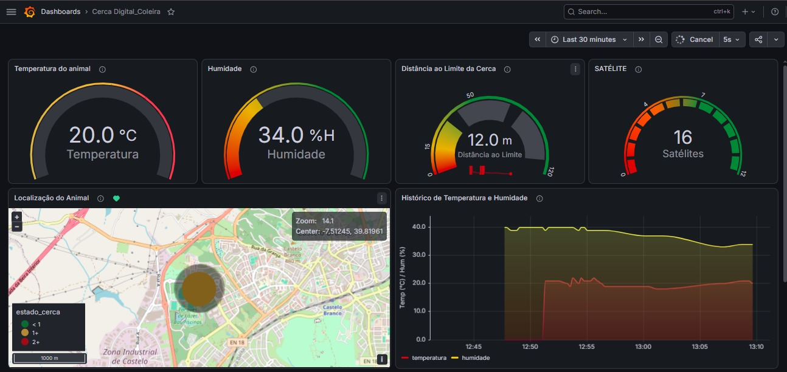

### State — Escape
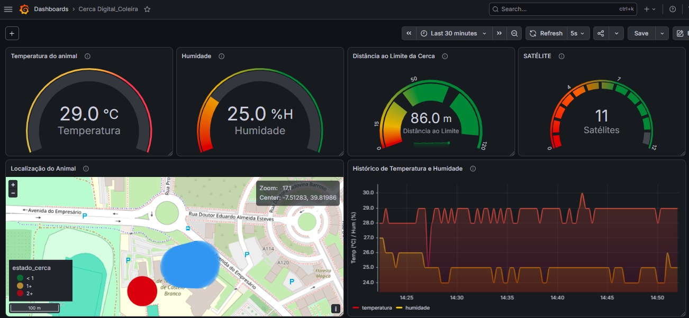

###  Dashboard — Alert
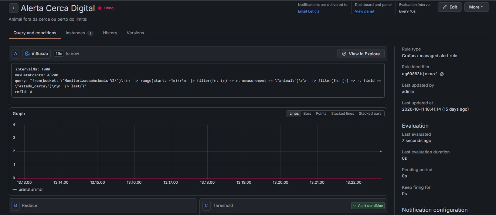

###  Email Alert
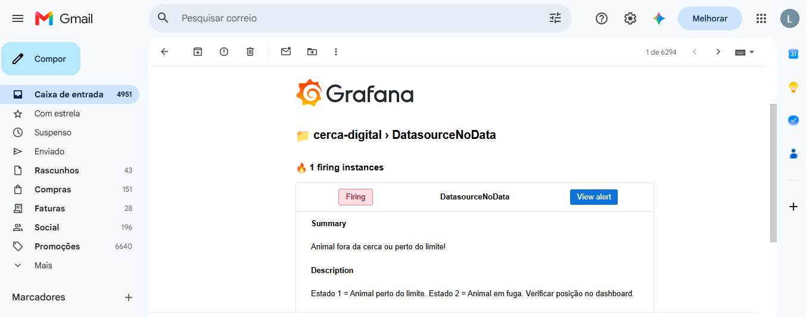
